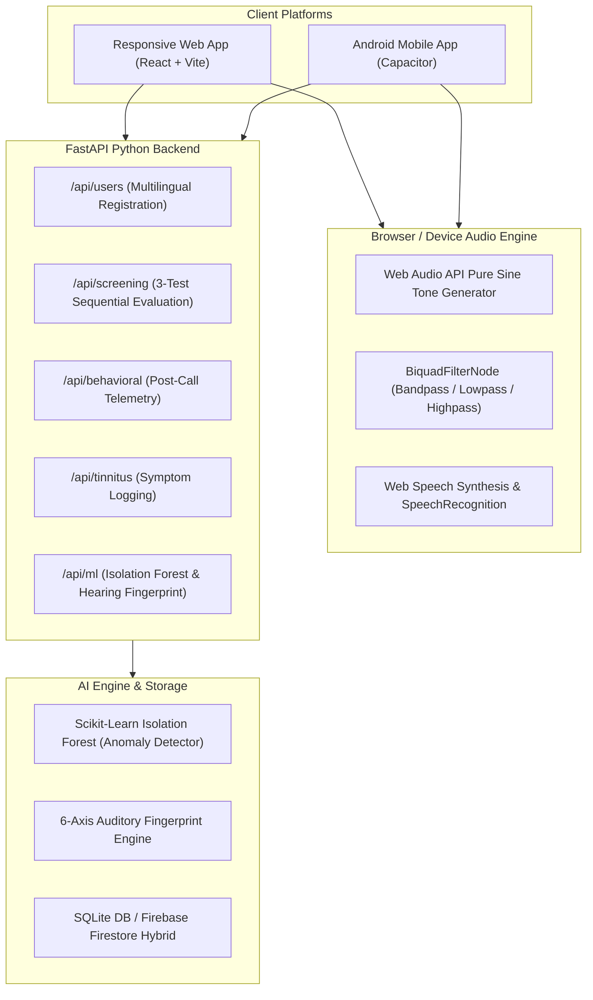

# EchoSense
> **AI-Powered Early Hearing Difficulty Screening System**  
> *Tagline: Listen Beyond the Silence.*

---

## 1. Project Overview

**EchoSense** is a modern, responsive, and cross-platform AI-powered hearing health screening application. Its core mission is to help individuals identify early, subtle signs of hearing difficulties by analyzing responses across:
1. Auditory frequency recognition (pure sinusoidal tones).
2. Speech-in-frequency repetition and acoustic memory under varying bandwidth conditions.
3. Consonant and phoneme discrimination across commonly confused minimal pairs.
4. Self-reported real-world communication difficulties through post-call behavioral monitoring.

The application is engineered as a unified cross-platform system:
- **Responsive Web Application:** Modern React 18, TypeScript, Tailwind CSS, Web Audio API, Web Speech API, and Chart.js.
- **Android Mobile Application:** Integrated via **Capacitor 6** with native microphone and audio playback configurations.
- **Unified Backend:** Python 3.11 with **FastAPI**, **Scikit-learn (Isolation Forest)**, **NumPy**, **Pandas**, and a hybrid **SQLite / Firebase Firestore** sync layer.

> **IMPORTANT MEDICAL NOTICE:**  
> ECHO SENSE is an early screening and awareness tool, **NOT** a medically certified hearing-loss diagnostic procedure or calibrated audiometer. It does not replace clinical evaluation by an audiologist or ENT specialist.

---

## 2. System Architecture



---

## 3. Multilingual Support & Registration

ECHO SENSE features comprehensive multilingual internationalization:
- **English** (`en`)
- **Hindi / हिन्दी** (`hi`)
- **Kannada / ಕನ್ನಡ** (`kn`)
- **Gujarati / ગુજરાતી** (`gu`)
- **Tamil / தமிழ்** (`ta`)
- **Telugu / తెలుగు** (`te`)
- **Bengali / বাংলা** (`bn`)
- **Marathi / मराठी** (`mr`)
- **Spanish / Español** (`es`)
- **French / Français** (`fr`)

The registration interface captures:
- Full Name
- Age
- Preferred Language (switchable at any point via the top navigation bar)
- Explicit user consent for audio generation and microphone capture

All test instructions, prompts, feedback, summaries, and disclaimers dynamically adapt to the selected language.

---

## 4. The Three Sequential Screening Tests

Tests are executed strictly in sequential order. Users cannot skip tests without an explicit exit confirmation modal.

### TEST 1: Repetition Detection Test
- **Objective:** Evaluate how accurately users recognize spoken sentences under 6 frequency-modulated acoustic stages.
- **Acoustic Stages:**
  1. *20 Hz – 20,000 Hz:* Full spectrum baseline.
  2. *20 Hz – 15,000–17,000 Hz:* Extended auditory bandwidth.
  3. *250 Hz – 12,000–14,000 Hz:* Typical conversational spectrum.
  4. *2,000 Hz – 8,000 Hz:* High-frequency speech band (voiceless consonants).
  5. *250 Hz – 2,000 Hz:* Fundamental speech-frequency band (vowel formants).
  6. *Age-Related Changes Reference:* Educational reference to presbycusis high-frequency sensitivity shifts.
- **Functionality:**
  - Speech synthesis speaks the sentence with audio cue.
  - **REPEAT Button:** Replays identical sentence while incrementing repetition counter.
  - User types what they heard into the input field.
  - Automatic string similarity scoring via Levenshtein / fuzzy phonemic matching.
  - Outputs total questions, correct/incorrect, total repetitions, and accuracy percentage.

### TEST 2: Misheard Word Detection Test
- **Objective:** Assess acoustic phoneme discrimination across commonly confused minimal pairs.
- **Word Pairs Evaluated:**
  - *Vowel Length:* Ship / Sheep, Fit / Feet, Bit / Beat
  - *Voiced vs Voiceless Fricatives:* Fan / Van, Fine / Vine, Fast / Vast
  - *Dental vs Plosive:* Thin / Tin, Three / Tree, Thank / Tank
  - *Bilabial Voicing:* Pat / Bat, Pin / Bin, Pig / Big
  - *Final Voicing:* Cap / Cab, Rope / Robe, Lap / Lab
- **Functionality:**
  - Audio playback with replay capability.
  - Microphone spoken input converted via Web Speech Recognition.
  - Instant phonemic feedback after every word.
  - **Adaptive Category Retry:** If incorrect, repeats category with an alternate minimal pair.
  - *Transparency Disclaimer:* Pronunciation is treated as a supplementary exercise, not a diagnostic classifier.

### TEST 3: Frequency Recognition Test
- **Objective:** Evaluate detection of pure sinusoidal audio tones across Low, Mid, and High frequency bands.
- **Frequencies Tested:**
  - *Low Frequency:* 250 Hz, 500 Hz
  - *Mid Frequency (Speech Band):* 1,000 Hz, 2,000 Hz, 4,000 Hz
  - *High Frequency:* 6,000 Hz, 8,000 Hz, 12,000 Hz
- **Functionality:**
  - Web Audio API pure sine wave generation with smooth linear ramp attack/decay envelope (eliminating speaker click artifacts).
  - Randomized tone trial presentation.
  - Pre-test quiet environment and headphone advisory checklist.
  - Clear **HEARD** vs **NOT HEARD** response buttons.
  - Dynamic calculation of detected vs missed tones and category detection rates.

---

## 5. Comprehensive Results Page

The final screening report synthesizes data across all three sequential tests:

1. **Overall Screening Summary:** Name, Age, Language, Timestamp.
2. **Individual Test Results:** Repetition test percentage, misheard words recognized, and tone detection percentage.
3. **Frequency Spectrum Profile:** Consistently detected bandwidths vs inconsistent or missed tones.
4. **Hearing Concern Indicator (Transparent Rule-Based Logic):**
   - **LOW:** No significant concern identified during this screening session. Responses were consistent across tested speech and frequency bands. *(Note: Low concern does not clinically rule out hearing loss).*
   - **MODERATE:** Inconsistent responses or subtle hearing difficulties observed across specific frequencies or spoken phrases.
   - **HIGH:** Multiple concerning observations detected across speech clarity and frequency detection. Professional audiological assessment recommended.
5. **Visual Results:**
   - Interactive Frequency Acuity Audiogram Curve (Chart.js Line).
   - Comparative Screening Accuracy Bar Chart.
6. **Thank You Message:**
   > *"Thank you for choosing ECHO SENSE. Your hearing health matters. Continue monitoring your hearing and consult a qualified professional if you experience difficulties."*
7. **Mandatory Medical Disclaimer:**
   > *"These tests are experimental and are not medically validated diagnostic procedures. ECHO SENSE only provides preliminary hearing-related screening observations. It cannot confirm or rule out hearing loss. For genuine hearing concerns, consult a qualified audiologist or healthcare professional."*
8. **Restart / Clear Test Session Button:** Confirmation modal ensures intentional reset of session data and returns user to registration.

---

## 6. Advanced AI Features

### A. Behavioral Hearing Monitoring
- Post-call questionnaire logging:
  - Phone call volume increases.
  - Repetition requests during calls.
  - Misunderstood words.
  - Background noise interference.
- **Privacy First:** Never records calls or accesses restricted audio; strictly self-reported observations.

### B. Personalized Hearing Fingerprint
- Generates a **6-Axis Auditory Radar Profile**:
  1. Speech Recognition Clarity
  2. Auditory Frequency Span
  3. Acoustic Repetition Resilience
  4. Consonant & Phoneme Distinction
  5. Everyday Conversation Comfort
  6. High-Frequency Sensitivity (with age-adjusted benchmark)
- Computes composite hearing health index (0–100) and actionable adaptive recommendations.

### C. AI-Based Behavioral Anomaly Detection
- Powered by **Scikit-learn Isolation Forest**.
- Learns normal personal listening baseline from sequential screenings and behavioral logs.
- Detects unusual deviations (e.g. 45% increase in repetition requests or 25% drop in high-frequency acuity).
- Generates transparent, explainable factor reports.

### D. Tinnitus Experience Tracker
- Tracks ringing, buzzing, humming, and whistling perceptions.
- Records frequency, duration, affected ear, and perceived severity (1–10).
- Educational notes emphasizing that tinnitus can occur with or without hearing loss.

### E. Hearing Trend Analysis
- Multi-session longitudinal trajectory analytics tracking accuracy and detection across time.

---

## 7. Technology Stack

| Layer | Technologies |
|---|---|
| **Frontend** | React 18, TypeScript, Tailwind CSS, Lucide React, Chart.js, react-chartjs-2 |
| **Audio & Speech** | Web Audio API (Oscillator, Gain, Analyser, BiquadFilter), Web Speech API |
| **Mobile App** | Capacitor 6 (Android native project, Manifest, App icon, Cleartext network) |
| **Backend** | Python 3.11, FastAPI, Uvicorn, Pydantic v2 |
| **Machine Learning** | Scikit-learn (Isolation Forest), NumPy, Pandas |
| **Database** | SQLite3 (Persistent local storage) + Firebase Firestore hybrid sync |

---

## 8. Quick Start Guide

### Option A: 1-Click Launch (Windows)
Double-click `start.bat` or run:
```powershell
.\start.ps1
```
This automatically starts:
- **Backend API:** `http://127.0.0.1:8000` (Swagger docs at `http://127.0.0.1:8000/docs`)
- **Frontend App:** `http://localhost:3000`

### Option B: Manual Launch

#### 1. Start the FastAPI Backend:
```bash
cd backend
python -u run.py
```

#### 2. Start the Frontend:
```bash
cd frontend
npm install
npm run build
npm run preview -- --port 3000 --host
```

#### 3. Android Mobile Build with Capacitor:
```bash
cd frontend
npm run build
npx cap sync
npx cap open android
```

---

## 9. Verification & Test Suite

Run the comprehensive Python backend and ML test suite:
```bash
python -u backend/tests/test_backend.py
```
**Tests Covered:**
- User registration and database persistence.
- Screening submission and rule-based hearing concern evaluation.
- Behavioral monitoring telemetry storage.
- Scikit-learn Isolation Forest model training, feature extraction, and anomaly scoring.
- Personalized 6-axis Hearing Fingerprint generation.

---

## 10. Final Word

**ECHO SENSE** bridges smartphone technology and artificial intelligence to bring early hearing difficulty awareness directly to individuals, encouraging timely professional audiological consultations.

*Listen Beyond the Silence.*
